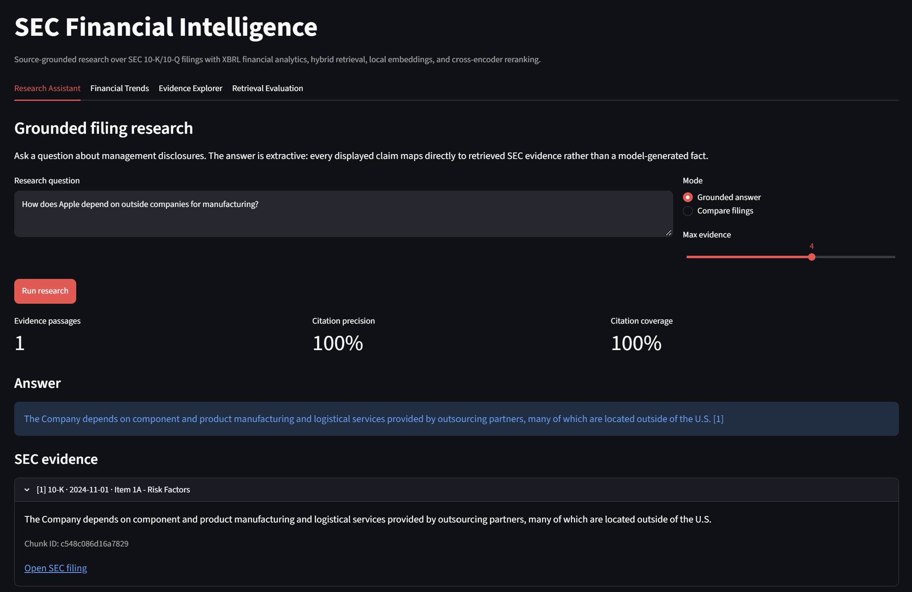
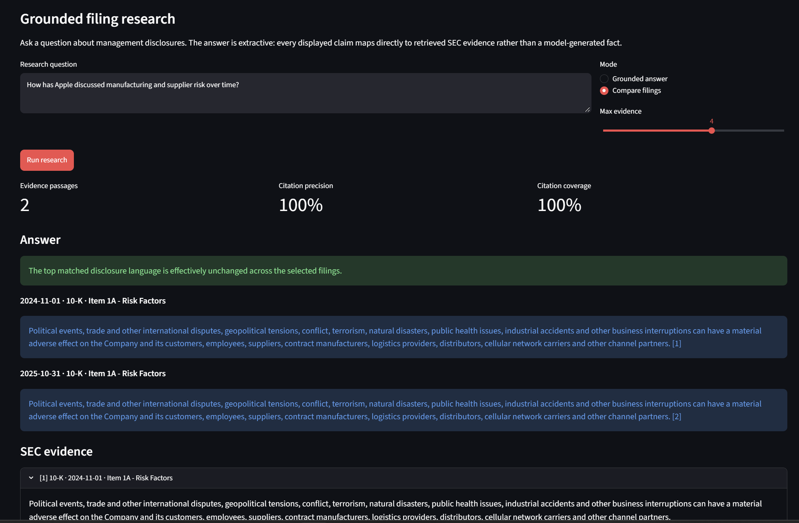
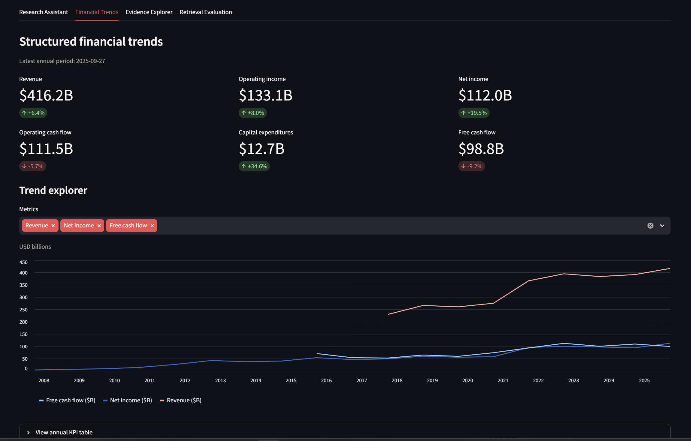
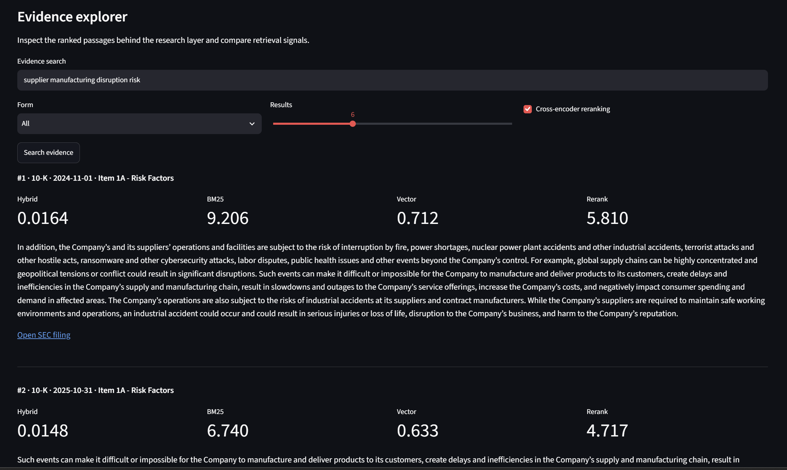
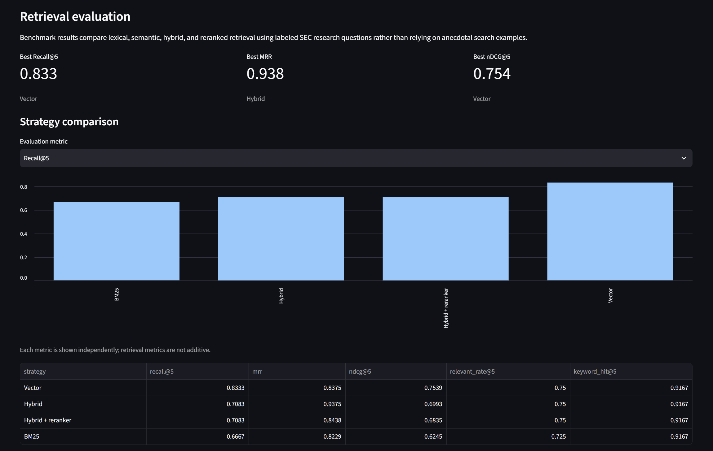
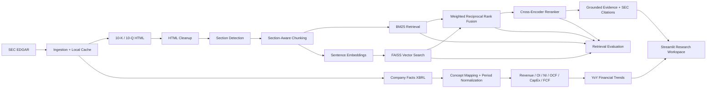

# SEC Financial Intelligence Platform

### Arham Nadeem

An end-to-end financial research platform that combines **SEC filing ingestion, XBRL financial analytics, section-aware document parsing, lexical + semantic retrieval, local cross-encoder reranking, source-grounded research answers, and quantitative retrieval evaluation**.

The project is built to answer questions such as:

- How has management's discussion of supplier or manufacturing risk changed across filings?
- What were the largest year-over-year changes in revenue, operating income, and free cash flow?
- Which filing passages best support a specific research question?
- Does semantic retrieval outperform lexical search for paraphrased financial research queries?

Unlike a generic "upload a PDF and chat with it" application, the platform separates **financial computation**, **document retrieval**, **ranking**, **source grounding**, and **evaluation** into independently testable components.

---

## Platform Preview

### Grounded Research Assistant



### Filing-to-Filing Comparison



### Structured Financial Trends



### Evidence Explorer



### Retrieval Evaluation



---

## Why This Project Exists

SEC filings combine two very different data problems:

1. **Structured financial analysis** — standardized financial facts, reporting periods, KPI calculations, and year-over-year trends.
2. **Unstructured financial research** — management commentary, risk disclosures, competitive language, operational dependencies, and changes in narrative over time.

A useful research system needs both. This project uses **SEC Company Facts / XBRL** for financial metrics while independently processing 10-K and 10-Q text for source-grounded research.

The result is a research workflow where financial calculations do not depend on an LLM, and document answers remain traceable to the underlying SEC filing.

---

## Architecture



### Research Pipeline

```text
Ticker
  ↓
SEC submissions + filing HTML + Company Facts
  ↓
Section-aware parsing and chunking
  ↓
BM25 lexical retrieval ──────────┐
                                 ├─ Weighted RRF ─ Cross-encoder reranking
Semantic embeddings + FAISS ────┘
                                              ↓
                                  Grounded SEC evidence
                                              ↓
                                   Citation-backed answer
```

---

## Core Technical Features

### 1. SEC EDGAR Ingestion

- Resolves ticker symbols to SEC CIK identifiers.
- Discovers recent 10-K and 10-Q filings from SEC submissions data.
- Downloads primary filing HTML from SEC archives.
- Retrieves structured Company Facts / XBRL data.
- Uses a declared SEC user agent and conservative request throttling.
- Caches source data locally to avoid unnecessary repeated requests.
- Writes a manifest containing filing type, filing date, accession number, source URL, and local file path.

### 2. Section-Aware Filing Parsing

The parser identifies filing structure before chunking instead of splitting a filing into arbitrary fixed windows.

Examples include:

- Item 1 — Business
- Item 1A — Risk Factors
- Item 7 — Management's Discussion and Analysis
- Item 7A — Quantitative and Qualitative Disclosures
- 10-Q Part I / Part II sections

The parser also includes logic to avoid mistaking table-of-contents entries for the substantive filing section.

Each research chunk preserves:

- ticker
- filing type
- filing date
- accession number
- section ID and title
- source URL
- stable chunk ID
- word count

### 3. Lexical Retrieval Baseline

A dependency-light **Okapi BM25** implementation provides the lexical baseline. It is strong when a research query uses the same financial or filing terminology as the source document.

### 4. Local Semantic Retrieval

The semantic layer uses:

- `sentence-transformers/all-MiniLM-L6-v2`
- normalized sentence embeddings
- FAISS inner-product search
- persisted local vector indexes
- chunk-file hashing to detect stale indexes

This allows paraphrased questions to retrieve relevant filing language even when the exact query words are absent.

### 5. Hybrid Retrieval

BM25 and vector scores are not directly comparable, so the project combines their **rank positions** using weighted Reciprocal Rank Fusion rather than naively adding raw scores.

Default weighting:

```text
BM25:  45%
Vector: 55%
```

### 6. Local Cross-Encoder Reranking

The top hybrid candidates can be reranked with:

```text
cross-encoder/ms-marco-MiniLM-L-6-v2
```

Unlike embedding retrieval, the cross-encoder reads the query and passage together, making it useful for improving the final ordering of a small candidate set.

### 7. Structured XBRL Financial Analytics

The financial layer normalizes SEC Company Facts into annual metrics including:

- Revenue
- Operating income
- Net income
- Operating cash flow
- Capital expenditures
- Free cash flow

It also handles repeated comparative XBRL facts by retaining the most recently filed version of each economic period before calculating trends.

Free cash flow is calculated as:

```text
Free Cash Flow = Operating Cash Flow - Capital Expenditures
```

### 8. Grounded Research Answers

The default answer layer is deliberately **extractive and citation-first**.

Each answer is tied to retrieved SEC evidence and includes:

- filing type
- filing date
- filing section
- chunk ID
- direct SEC filing URL

The system also supports filing-to-filing comparison and can identify when the strongest disclosure language is effectively unchanged across years.

No paid LLM API is required for the core project.

### 9. Retrieval Evaluation

The repository contains a manually labeled Apple research benchmark and compares:

1. BM25
2. Vector retrieval
3. Hybrid retrieval
4. Hybrid + cross-encoder reranking

Metrics include:

- **Recall@5** — whether expected relevant sections were retrieved
- **MRR** — how early the first relevant result appeared
- **nDCG@5** — ranking quality across retrieved evidence
- **Relevant Result Rate@5** — proportion of the top results matching labeled sections
- **Keyword Hit@5** — whether expected evidence terminology appeared

---

## Measured Results

### AAPL Retrieval Benchmark

Results from the included **8-question AAPL benchmark**:

| Strategy | Recall@5 | MRR | nDCG@5 | Relevant Rate@5 | Keyword Hit@5 |
|---|---:|---:|---:|---:|---:|
| **Vector** | **0.833** | 0.838 | **0.754** | 0.750 | 0.917 |
| **Hybrid** | 0.708 | **0.938** | 0.699 | 0.750 | 0.917 |
| Hybrid + reranker | 0.708 | 0.844 | 0.684 | 0.750 | 0.917 |
| BM25 | 0.667 | 0.823 | 0.625 | 0.725 | 0.917 |

The benchmark shows that the more complex method does not automatically win every metric:

- Vector retrieval achieved the strongest overall Recall@5 and nDCG@5.
- Hybrid retrieval achieved the best MRR, placing a relevant result very high in the ranking.
- The reranker improved individual queries but did not improve every aggregate metric.

This evaluation is intentionally retained as measured rather than tuned to make the most complex strategy appear best.

### Example AAPL Corpus Run

A local run using two recent 10-Ks and two recent 10-Qs produced:

```text
Filings processed: 4
Sections detected: 50
Research chunks: 455
```

Example latest annual KPI snapshot (`2025-09-27`):

| Metric | Value | YoY |
|---|---:|---:|
| Revenue | $416.2B | +6.4% |
| Operating income | $133.1B | +8.0% |
| Net income | $112.0B | +19.5% |
| Operating cash flow | $111.5B | -5.7% |
| Capital expenditures | $12.7B | +34.6% |
| Free cash flow | $98.8B | -9.2% |

---

## Streamlit Research Workspace

The application contains four integrated views.

### Research Assistant

- grounded SEC research questions
- citation precision and coverage checks
- expandable source evidence
- direct links to SEC filings
- filing-to-filing comparison mode

### Financial Trends

- KPI cards
- year-over-year changes
- interactive metric selection
- multi-year trend charts in USD billions
- raw annual KPI and growth tables

### Evidence Explorer

- query SEC filing chunks directly
- filter by filing type
- inspect BM25, vector, hybrid, and reranker scores
- toggle cross-encoder reranking
- open the original SEC source

### Retrieval Evaluation

- inspect the labeled benchmark
- compare retrieval strategies using one metric at a time
- view Recall@5, MRR, nDCG@5, relevant-result rate, and keyword coverage

---

## Project Structure

```text
sec-financial-intelligence/
├── config/
│   └── settings.yaml
├── data/
│   ├── evaluation/
│   │   └── aapl_questions.yaml
│   ├── indexes/
│   ├── processed/
│   └── raw/
├── screenshots/
│   ├── 01_research_assistant.png
│   ├── 02_filing_comparison.png
│   ├── 03_financial_trends.png
│   ├── 04_evidence_explorer.png
│   └── 05_retrieval_evaluation.png
├── scripts/
│   ├── build_vector_index.py
│   ├── compare_retrieval.py
│   ├── evaluate_retrieval.py
│   ├── extract_financials.py
│   ├── ingest_sec.py
│   ├── parse_filings.py
│   ├── research_sec.py
│   ├── run_app.py
│   ├── search_bm25.py
│   ├── search_hybrid.py
│   └── search_vector.py
├── src/sec_intelligence/
│   ├── analytics/
│   ├── answering/
│   ├── evaluation/
│   ├── ingestion/
│   ├── parsing/
│   ├── retrieval/
│   ├── ui/
│   ├── config.py
│   └── models.py
├── tests/
├── .env.example
├── .gitignore
├── pyproject.toml
└── README.md
```

---

## Setup

Python 3.11+ is recommended.

### 1. Create a virtual environment

```bash
python -m venv .venv
```

Windows PowerShell:

```powershell
.venv\Scripts\Activate.ps1
```

macOS/Linux:

```bash
source .venv/bin/activate
```

### 2. Install the project

```bash
python -m pip install --upgrade pip
python -m pip install -e ".[dev]"
```

### 3. Identify SEC requests

The SEC asks automated clients to identify themselves. The recommended approach is an environment variable so personal contact information is not committed.

Windows PowerShell:

```powershell
$env:SEC_USER_AGENT="Your Name your.email@example.com"
```

macOS/Linux:

```bash
export SEC_USER_AGENT="Your Name your.email@example.com"
```

---

## Build the AAPL Dataset

### Download filing data

```bash
python scripts/ingest_sec.py AAPL --max-per-form 2
```

### Parse sections and chunks

```bash
python scripts/parse_filings.py AAPL
```

### Extract financial KPIs

```bash
python scripts/extract_financials.py AAPL
```

### Build the semantic index

```bash
python scripts/build_vector_index.py AAPL
```

The first semantic-search run downloads the public sentence-transformer model. Model weights are then cached locally.

### Evaluate retrieval

```bash
python scripts/evaluate_retrieval.py AAPL
```

### Launch the Streamlit app

```bash
python scripts/run_app.py
```

---

## CLI Research Examples

BM25 baseline:

```bash
python scripts/search_bm25.py AAPL "supply chain manufacturing risk"
```

Semantic search:

```bash
python scripts/search_vector.py AAPL "dependence on outside companies to make its products"
```

Hybrid + reranker:

```bash
python scripts/search_hybrid.py AAPL "supplier manufacturing disruption risk"
```

Compare retrieval strategies:

```bash
python scripts/compare_retrieval.py AAPL "dependence on outside companies to make its products"
```

Grounded answer:

```bash
python scripts/research_sec.py AAPL "How does Apple depend on outside companies for manufacturing?"
```

Compare filing language:

```bash
python scripts/research_sec.py AAPL "How has Apple discussed manufacturing and supplier risk over time?" --compare
```

---

## Testing

Run the complete automated test suite with:

```bash
python -m pytest
```

Tests cover areas including:

- SEC URL and metadata handling
- filing section detection
- section-aware chunking
- BM25 retrieval
- vector retrieval
- hybrid fusion
- cross-encoder reranking behavior
- XBRL financial calculations
- ranking metrics
- grounded citation logic
- Streamlit presentation helpers

Live SEC requests and external model downloads are not required for the unit tests.

---

## Free / Local Design

| Component | Implementation | Cost |
|---|---|---:|
| Filing metadata | SEC EDGAR submissions | Free |
| Filing documents | SEC EDGAR archives | Free |
| Structured financial facts | SEC Company Facts / XBRL | Free |
| Parsing | BeautifulSoup + Python | Free/local |
| Lexical retrieval | Custom BM25 | Free/local |
| Embeddings | sentence-transformers | Free/local |
| Vector search | FAISS | Free/local |
| Reranking | local cross-encoder | Free/local |
| Financial analytics | pandas | Free/local |
| Interface | Streamlit | Free/local |
| Evaluation | pytest + custom metrics | Free/local |
| Paid LLM API | Not required | $0 |

---

## Technical Decisions

### Why not use an LLM for financial calculations?

Financial arithmetic is deterministic. Revenue, cash flow, and free-cash-flow calculations come from structured SEC facts rather than generated text.

### Why combine BM25 and embeddings?

Exact terminology matters in financial filings, but research questions are often paraphrased. BM25 handles exact language well, while embeddings improve semantic matching.

### Why use RRF instead of adding BM25 and vector scores?

The two retrieval methods produce scores on different scales. Reciprocal Rank Fusion combines ranking positions rather than pretending the raw scores are directly comparable.

### Why keep the answer layer extractive?

The core goal is verifiability. Extractive answers make every displayed claim traceable to SEC evidence while keeping an optional generative layer separate from the trusted retrieval pipeline.

---

## Limitations and Future Work

- The included retrieval benchmark contains 8 manually labeled AAPL questions; a larger benchmark would improve statistical confidence.
- SEC HTML structures and XBRL taxonomy choices vary across issuers, so additional companies may require parser or concept-mapping adjustments.
- Filing comparison currently focuses on retrieving the strongest topic-aligned evidence rather than generating a long-form narrative explanation.
- Local transformer models can take several seconds to load on first use; the Streamlit app lazy-loads them and caches them for later requests.
- A future optional LLM synthesis layer could summarize already-grounded evidence while enforcing citation constraints.

---

## Data and Usage Note

SEC filings are public source documents. This project is intended for financial research and analytics demonstrations, not investment advice. Financial concepts can vary by issuer, taxonomy choice, and reporting period, so structured metrics should be validated before being used in production decision-making.
